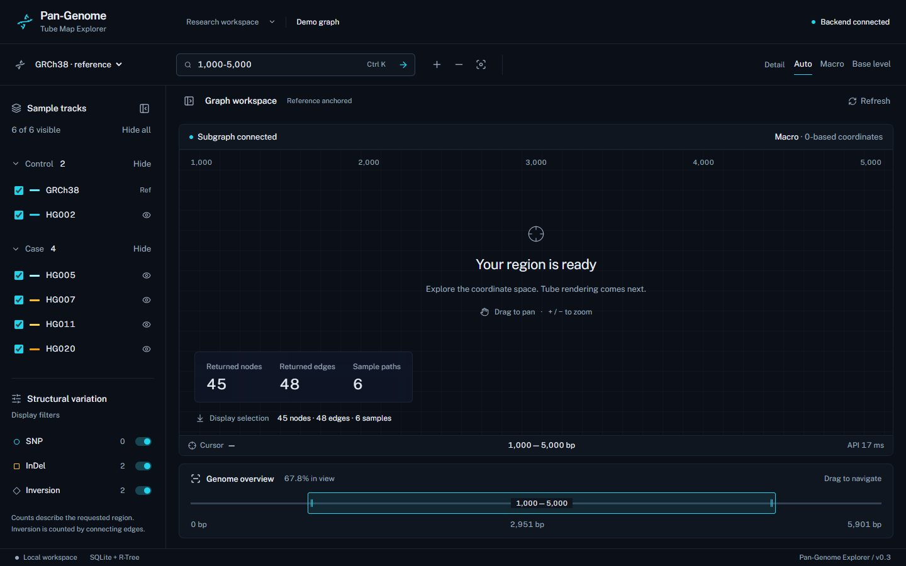

# Pan-Genome Tube Map Explorer

当前实现：**Step 1 — GFA 解析与 SQLite 存储索引**、**Step 2 — 地铁图布局与 FastAPI 子图接口**、**Step 3 — 暗黑前端工作台与 API 联调**。后端 Python 3.10+，前端 Node.js 20.9+（本地验证使用 Node 24）。Step 1 仅使用标准库；Step 2 依赖见 `backend/requirements.txt`。

## 运行（PowerShell）

```powershell
cd 'D:\大学\生物信息学项目\Pan-Genome-Tube-Map-Explorer'
python backend/seed_mock_gfa.py
python -m unittest backend.test_data_layer -v
```

默认输出 `backend/data/sample_pangenome.gfa` 和 `backend/data/pangenome.db`。仓库包含已生成样例；再次运行时请选择新目录，程序拒绝覆盖已有文件：

```powershell
python backend/seed_mock_gfa.py --output-dir backend/data-local
python backend/gfa_parser.py backend/data/sample_pangenome.gfa backend/custom.db --reference GRCh38
```

解析器的目标数据库必须为空。第一次 P 记录默认作为参考，也可用 `--reference` 显式选择。所有数据写入使用事务；解析失败不会写入半份图数据。测试使用临时目录保留测试夹具，不主动删除文件。

## 数据结构与坐标

- `nodes`：字符串 GFA ID、序列、长度、主干标志、参考区间；`*` 序列必须提供 `LN:i:`。
- `edges`：有向 GFA 连边与双方方向、原始 overlap CIGAR、`normal/insertion/deletion/inversion` 类型。反向互补连边隐式可用，不重复存储。
- `paths`：样本主键、分组、JSON 步骤数组，格式 `[{"node_id":"1","orientation":"+"}]`。分组读取自可选 `GN:Z:` 标签，缺省 `Unknown`。
- 参考坐标使用 **0-based 半开区间**。主干累计序列长度并扣除相邻 overlap；参考中的重复节点无法用单一区间表示，明确拒绝。
- 非主干节点按连通分量收集主干锚点，投影至最左锚点末端和最右锚点起点之间。多跳分支和环使用同一区间；只有一个锚点时采用该锚点区间；无锚点时为 NULL，不参与参考区间查询。这是保守近似，不是序列比对。
- 相邻主干间插入投影为零宽坐标，查询区间包含该点时召回；SNP 替代节点投影到被替代参考区间。
- 建立 `ref_start/ref_end` B-tree 索引及 `rtree_i32` 区间索引，触发器同步索引。支持单参考坐标范围 0–2,147,483,647；超范围拒绝导入。
- SV 分类是拓扑启发式：参考相邻边 normal；反向参考遍历 inversion；接触零宽分支 insertion；跳过参考区间 deletion。SNP 连边记 normal（给定枚举没有 SNP）。真实复杂图的最终变异判定需要比对和样本上下文。
- 支持 GFA 1.0/1.1 的 H/S/L/P；其他记录明确报错。参考 overlap 为 `*` 时从 L 推导；缺失或歧义时拒绝。不会尝试构建未知重叠坐标。

## 模拟变异

固定随机种子 `20261105`，62 个节点（60 主干 + 2 变异），参考长度 5901 bp，6 个样本：

| 样本 | 分组 | 路径特征 |
|---|---|---|
| GRCh38 | Control | 参考 |
| HG002 | Control | 节点 10 的单碱基 SNP 气泡，区间 [900,901) |
| HG005 | Case | 节点 20 与 21 间插入 500 bp，锚点 1901 |
| HG007 | Case | 删除节点 30–39，共 1000 bp，区间 [2801,3801) |
| HG011 | Case | 节点 45–49 倒位，按 49- 到 45- 遍历，形成倒位回环 |
| HG020 | Case | 同时携带以上四类事件 |

## 本地验收

```powershell
python -c "from backend.database import connect,statistics; import json; c=connect('backend/data/pangenome.db'); print(json.dumps(statistics(c),indent=2)); print(c.execute('PRAGMA integrity_check').fetchone()[0]); print(c.execute('PRAGMA foreign_key_check').fetchall()); c.close()"
python -c "from backend.database import connect,query_region; c=connect('backend/data/pangenome.db'); print(query_region(c,900,901)); print(query_region(c,1901,1902)); c.close()"
python -c "from backend.database import connect; c=connect('backend/data/pangenome.db'); print([tuple(r) for r in c.execute('SELECT sample_id,group_name,json_array_length(node_path) FROM paths')]); print([tuple(r) for r in c.execute('SELECT sv_type,count(*) FROM edges GROUP BY sv_type')]); c.close()"
```

预期：62 nodes、66 edges、6 paths、60 backbone nodes、62 anchored nodes；边类型为 normal=61、insertion=2、deletion=1、inversion=2；完整性 `ok`，外键异常 `[]`。SNP 区间召回 `10` 和 `snp_alt`，插入锚点召回 `21` 和 `ins_500`。单元测试覆盖四类变异、半开边界、多跳锚定、孤立节点、反向重叠、索引计划和非法输入。

## Step 2：启动 API

在仓库根目录执行：

```powershell
python -m venv .venv
.venv\Scripts\python -m pip install -r backend/requirements-dev.txt
.venv\Scripts\python -m uvicorn backend.main:app --host 127.0.0.1 --port 8000
```

生产运行仅需安装 `backend/requirements.txt`。默认读取仓库中的 `backend/data/pangenome.db`。可在启动前配置：

```powershell
$env:PANGENOME_DB = (Resolve-Path 'backend/data-local/pangenome.db').Path
$env:CORS_ORIGINS = 'http://localhost:3000,http://127.0.0.1:3000'
```

数据库以只读模式、每次请求独立连接和一致读事务访问；文件不存在或表结构不可用时返回 HTTP 503。CORS 默认允许上述两个本地前端来源的 GET 请求，支持 OPTIONS 预检，无凭据通配。实现依据 [FastAPI CORS 文档](https://fastapi.tiangolo.com/tutorial/cors/)。

Swagger 文档：<http://127.0.0.1:8000/docs>。

另开 PowerShell 验收：

```powershell
curl.exe --fail "http://127.0.0.1:8000/api/genome/meta"
curl.exe --fail "http://127.0.0.1:8000/api/subgraph?start=900&end=901&lod=micro"
curl.exe --fail "http://127.0.0.1:8000/api/subgraph?start=1800&end=2000&lod=macro"
curl.exe --fail "http://127.0.0.1:8000/api/subgraph?start=3200&end=3300&lod=macro"
curl.exe --fail "http://127.0.0.1:8000/api/subgraph?start=4200&end=5000&lod=micro"
curl.exe -i "http://127.0.0.1:8000/api/subgraph?start=100&end=100&lod=macro"
curl.exe -i -X OPTIONS "http://127.0.0.1:8000/api/subgraph" -H "Origin: http://localhost:3000" -H "Access-Control-Request-Method: GET"
.venv\Scripts\python -m unittest backend.test_data_layer backend.test_layout_api -v
```

上述窗口依次验证 SNP、插入、跨窗口缺失、倒位、非法区间 422 与跨域预检。13 项测试覆盖存储、循环分支、布局确定性、节点不重叠、轨道间距、曲线切线和连接连续性、反向端口、LOD、窗口外空结果与数据库故障。

`GET /api/genome/meta` 返回 `total_length=5901`、62 节点、66 连边、6 样本及 Control/Case 的样本分组列表。

`GET /api/subgraph` 参数为 `start`、`end` 和 `lod=macro|micro`，仍使用 **[start,end)**。非整数、负值、空/倒置区间、未知 LOD 或超出 32 位坐标范围返回 422。超出参考末端的合法区间可返回空子图。子图超过 5000 节点返回 413，提示缩小窗口。

完整真实 HTTP 响应保存在 [`backend/examples/subgraph_snp_micro.json`](backend/examples/subgraph_snp_micro.json)。该响应有 4 节点、4 连边、6 样本轨道；`snp_alt` 的几何信息为 `x=160,y=-78,width=24`，主干节点 `10` 的 `y=0`。响应字段：

| 字段 | 含义 |
|---|---|
| `nodes` | 节点坐标、宽高、参考坐标、方向、拓扑深度、轨道槽和每样本偏移 |
| `edges` | 原始 GFA 连边、SV 类型、使用它的样本以及 `segments` 三次贝塞尔数组 |
| `tracks` | 样本/分组、固定偏移、保持原路径顺序的 `fragments`，包含步骤和完整绘制曲线 |
| `summary` | SNP 气泡、插入/替代分量、缺失/倒位边数及边类型统计 |
| `bounds` | 包含节点与所有曲线控制点的像素包围盒 |

每段曲线提供 `x1,y1,cp1x,cp1y,cp2x,cp2y,x2,y2`。Canvas 可按顺序调用 `moveTo(x1,y1)` 和 `bezierCurveTo(cp1x,cp1y,cp2x,cp2y,x2,y2)`。`tracks.fragments[].segments` 已包含节点内部直线、样本偏移和节点间连接，可直接绘制每个单倍型轨道。

### 布局约定

- 像素坐标 +Y 向下；主干中心线严格为 Y=0，按参考顺序从左至右排列。macro 节点宽度为 `24 + 24*log10(max(1,length))`；micro 为 `max(24,0.8*length)`；主干间保留 40 px 间距。因此 X 是显示坐标，不等于基因组 bp。
- 插入和普通气泡分支在上方；倒位分支在下方。通过多源 BFS 计算拓扑深度，带环图也能终止。对重叠的 X 占用区间分配不同槽位，槽距随样本数增大，防止节点矩形相互重叠。此规则保证节点占位，不保证复杂图的全局最少交叉。
- 样本按 ID 排序，固定偏移 `(k-(N-1)/2)*6` px，在整个子图中一致；主干中心仍为零，同节点的不同样本相隔 6 px。
- 每条曲线起终切线均水平。缺失与倒位边使用下方独立槽和三段连续三次贝塞尔，避免同高端点的单段曲线退化成直线。每段共享端点并保持水平切线方向连续；反向 GFA 端口和样本遍历使用反向曲线。
- macro 不返回序列（`sequence=null`）；micro 返回存储序列。两个 LOD 都保留拓扑和样本路径，不丢弃 SNP。
- 用 R-Tree 召回窗口内节点，再加入一跳邻居和横跨窗口的缺失/倒位端点（`context_only=true`），最后返回这些节点间的诱导连边。上下文节点不会自动扩展整条染色体。
- 样本路径在未返回的节点处切分 `fragments`，保持真实的原路径索引，不跨空缺伪造连线。环和重复步骤保留顺序。
- 统计按拓扑分量及边计数，不将两条倒位边误称为两个生物学倒位事件：全图 SNP=1、插入分量=1、缺失边=1、倒位边=2。`summary.edge_counts` 仅统计触及或横跨窗口的边，可能少于含上下文的全部 `edges`。
- 当前同步实现限制局部节点数；恢复参考方向和样本轨道时仍会读取全体参考节点与路径 JSON。尚未实现染色体级预计算、路径区间索引或缓存。

## Step 3：前端工作台

Next.js App Router + TypeScript + Tailwind CSS 4，采用本地 Public Sans 字体和 Lucide 图标。前端只实现 UI、交互容器和数据状态，不包含 Canvas/Pixi 地铁轨道渲染。

终端 A，在仓库根目录启动后端（首次运行先按 Step 2 安装依赖）：

```powershell
.venv\Scripts\python -m uvicorn backend.main:app --host 127.0.0.1 --port 8000
```

终端 B：

```powershell
cd frontend
npm ci
npm run dev
```

打开 <http://127.0.0.1:3000>。页面通过同源 `/api/genome/meta`、`/api/subgraph` 请求，由 Next.js rewrite 转发到 `http://127.0.0.1:8000`。默认无需修改后端 CORS。自定义后端地址可参照 `frontend/.env.example`，在启动或构建前设置 `BACKEND_URL`，例如 `$env:BACKEND_URL='http://127.0.0.1:8001'`。生产构建与启动使用相同环境设置。

生产验收（先停止开发服务器，保留后端）：

```powershell
npm run build
npm run lint
npm run typecheck
npm run start
```

第三个终端，在 `frontend/` 中执行：

```powershell
# Windows 默认使用已安装的 Edge；其他系统先安装 Chromium
# npx playwright install chromium
npm run test:e2e -- --output="../.taste-skill/test-$(Get-Date -Format yyyyMMdd-HHmmss)"

# 验证 Next.js 转发的真实 API
curl.exe --fail "http://127.0.0.1:3000/api/genome/meta"
curl.exe --fail "http://127.0.0.1:3000/api/subgraph?start=900&end=901&lod=micro"
```

可用 `PLAYWRIGHT_CHANNEL` 指定浏览器通道，`FRONTEND_URL` 指定测试地址。浏览器测试使用真实成功请求，并单独模拟故障测试重试逻辑；测试结果目录使用时间戳保留历史文件。

### 手动验收清单

1. 首屏默认区间 `[1000,5000)`，HUD 应显示 45 nodes、48 edges、6 sample paths；Control 2 个样本、Case 4 个样本均来自 API。API 状态和耗时来自实际请求。
2. 搜索 `900-901` 并回车，HUD 显示 4 nodes、4 edges。也接受逗号、短横线/长横线/冒号分隔。输入 `5000-1000` 显示校验提示并保留有效视口。
3. 点击 Zoom In/Out；Reset 恢复 `[0,5901)`，HUD 显示 62 nodes、66 edges。Auto 在跨度不超过 1500 bp 时请求 micro，否则请求 macro；两个手动模式会强制请求相应 LOD。
4. 拖动中央网格平移；鼠标移动更新 Cursor bp。聚焦容器后可用左右方向键平移、`+/-` 缩放。`Ctrl/Cmd+K` 聚焦区间搜索。
5. 拖动 Genome overview 的高亮窗口，主视口和请求同步变化。该滑块支持左右方向键、Home、End，且边界被限制在参考长度以内。
6. 勾选/取消样本，或按 Control/Case 分组显隐；SNP/InDel/Inversion 开关更新本地 Display selection 数量，原始 Returned nodes/edges 保留后端返回值。图中的样本显隐与过滤偏好保存在当前 React 会话，不修改数据库。
7. 在 `900-901` 窗口关闭 SNP，Display selection 应从 4 nodes/4 edges 变为 3 nodes/2 edges。普通主干仍保留；SNP 分类来自当前节点拓扑，InDel 来自插入/缺失，Inversion 来自倒位边。
8. 停止后端后点击 Refresh，页面显示错误和 Retry connection；重启后端并重试可恢复。查询有 160 ms 防抖、15 秒超时与 AbortController 取消，旧结果不会作为新窗口数据显示。
9. 390 px 和 768 px 下侧栏折叠为抽屉；顶部按钮打开控制舱，Escape 或遮罩关闭，键盘焦点保留在打开的抽屉内。

参考选择器当前仅有模拟数据库的 GRCh38 单参考；Step 2 元数据没有染色体目录，因此不提供虚构染色体选项。样本与变异过滤在前端计算显示偏好，不增加 Step 2 未提供的 API 参数。倒位数沿用后端的**连边计数**。

### 前端文件

| 文件 | 职责 |
|---|---|
| `frontend/src/components/workbench.tsx` | 整体布局、顶部控制栏、共享区间与显示偏好状态 |
| `frontend/src/components/sample-sidebar.tsx` | 分组样本复选框、变异开关 |
| `frontend/src/components/viewport.tsx` | 网格占位、指针坐标、拖动与 API HUD |
| `frontend/src/components/minimap.tsx` | 按真实比例展示并拖动的参考范围条 |
| `frontend/src/lib/use-genome-api.ts` | 防抖、取消、超时、加载与失败状态 |
| `frontend/src/lib/region.ts` | 区间解析、缩放与边界约束 |
| `frontend/src/lib/types.ts` | 与 Step 2 对齐的数据契约 |
| `frontend/tests/workbench.spec.ts` | 四个浏览器验收场景 |

验证记录：生产构建、ESLint、TypeScript 全部通过；4 个浏览器测试通过；1440/768/390 三尺寸视觉检查为 0 FAIL、2 WARN（紧凑元数据字号、按本步要求保留的开放网格）。设计方向与复核说明见 [`frontend/DESIGN.md`](frontend/DESIGN.md)。框架配置依据 [Next.js 安装文档](https://nextjs.org/docs/app/getting-started/installation) 和 [Tailwind Next.js 集成文档](https://tailwindcss.com/docs/installation/framework-guides/nextjs)。


